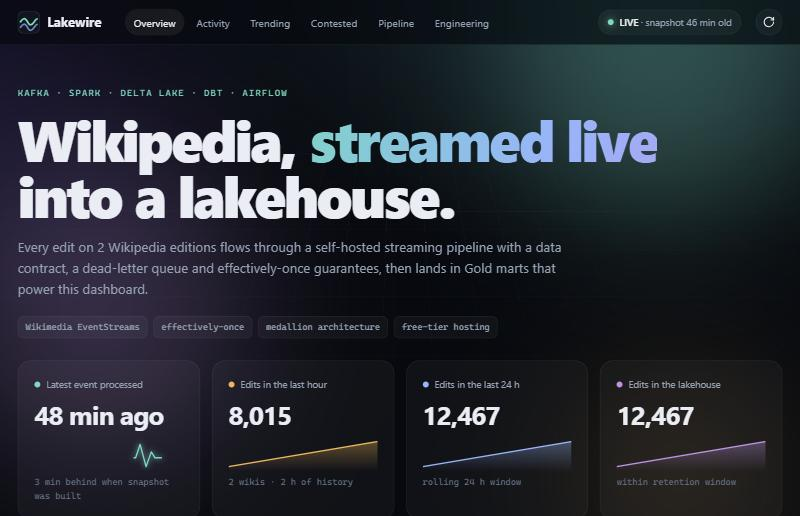
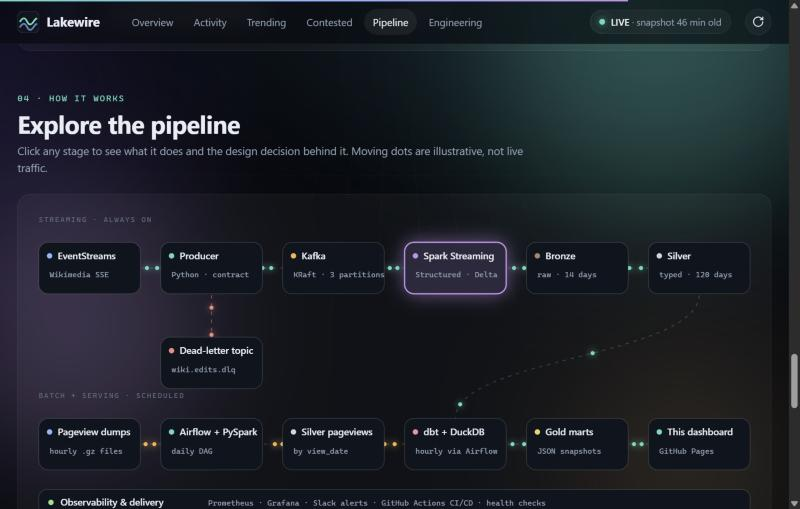
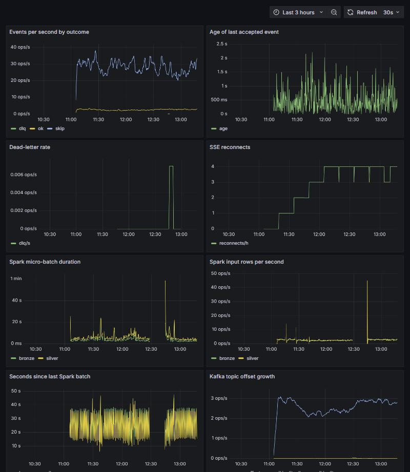

# Lakewire

[](https://github.com/Mukesh7522/Lakewire/actions/workflows/ci.yml)
**[Live dashboard](https://mukesh7522.github.io/Lakewire/)** · [Project summary](docs/SUMMARY.md) · [Incident reports](docs/incidents/) · [Runbook](docs/RUNBOOK.md) · [Deploying](docs/DEPLOY.md)

A lakehouse for Wikipedia activity that publishes a public dashboard to GitHub Pages. It runs in one of two ways: a **lite** version entirely on scheduled GitHub Actions (free, nothing to host), or the **full** Kafka and Spark stack from one `docker-compose.yml` on your own computer or a VM. The live dashboard says which one is running.



```
Wikimedia EventStreams ─► producer ─► Kafka ─► Spark Structured Streaming ─► Delta (Bronze ─► Silver) ─┐
                         (contract + DLQ)                                      on SeaweedFS (S3-compatible) │
Wikimedia pageview dumps ─► Airflow ─► PySpark ─► Delta (Silver, per-day overwrite) ─────────────────────┤
                                                                                                        ▼
                                          dbt + DuckDB (hourly, Airflow) ─► Gold marts ─► JSON ─► GitHub Pages
Prometheus + Grafana  ·  Slack alerts  ·  GitHub Actions CI/CD
```

The dashboard's pipeline explorer lets you click each stage for what it does and why it was built that way:



All software is open source. The diagram above is the full version. The lite version replaces Kafka, Spark and Airflow with a scheduled job:

```
Wikimedia EventStreams ─► collector (contract + DLQ) ─► dedupe + merge ─► Parquet files in a git branch ─┐
  (replayed hourly from a saved position)                                                                │
Wikimedia pageview dumps ─► daily job (DuckDB) ─► Parquet (top pages per hour) ────────────────────────┤
                                                                                                         ▼
                       dbt + DuckDB (rebuilt every hour, all data tests) ─► Gold marts ─► JSON ─► GitHub Pages
```

Both versions feed the same dbt models and the same dashboard. How to run either one: `docs/DEPLOY.md`.

## What runs where

**Lite version (GitHub Actions only, nothing to host):**

| Piece | Where | Schedule |
|---|---|---|
| Collect new edits, store them, rebuild the marts, publish | GitHub Actions `lite-hourly.yml` | hourly, at :23 |
| Load the previous day's pageviews | GitHub Actions `lite-pageviews.yml` | daily |
| Data and published site | two git branches, each replaced by one commit per run | every run |

**Full version (Docker):**

| Piece | Where | Schedule |
|---|---|---|
| Producer, Kafka, Spark streaming, SeaweedFS (S3), Airflow, Prometheus, Grafana | Docker on one machine (your computer or a VM) | always on, `restart: unless-stopped` |
| Marts refresh + JSON export | Airflow `lakewire_marts_hourly` | hourly |
| Pageview backfill | Airflow `lakewire_pageviews_daily` | daily, waits for the dump, retries |
| Delta compaction, retention, VACUUM | inside the streaming driver | every 6 h / daily |
| CI (lint, tests, dbt, end-to-end) | GitHub Actions `ci.yml` | every push and PR |
| CD (deploy to VM + health check) | GitHub Actions `cd.yml`, VM path only | after CI passes on `main` |
| Dashboard publish + freshness alarm | VM path: GitHub Actions `publish.yml` every 2 h. Own computer: `scripts/publish_local.ps1` | scheduled |

## Design decisions worth knowing

- **One writer per Delta table.** Delta on S3-compatible storage has no atomic put-if-absent, so compaction and retention run inside the same JVM as the streaming queries instead of in a second process. Airflow only writes the pageviews table.
- **Effectively-once.** Kafka is at-least-once. A watermark plus `dropDuplicatesWithinWatermark` bounds state, and an insert-only `MERGE` on `event_id` makes redelivery harmless. CI replays the same events twice and asserts Silver does not change.
- **Data contract at the edge.** Events that break `lakewire/contracts/recentchange.schema.json` go to `wiki.edits.dlq`. Additive fields pass; type changes and missing required fields do not.
- **Disk budget.** Bronze keeps 14 days, Silver 120 days, Kafka 48 hours, and only a few wikis are ingested. Marts in DuckDB are small and kept. Measure your real growth in the first week (`docs/RUNBOOK.md`).
- **Resumable ingestion.** The producer saves its Wikimedia stream position on a Docker volume and resumes from it after a restart, so an outage does not drop events (replays are harmless because Silver dedupes on `event_id`). Verified on a real 58-minute laptop sleep: the missed hour was backfilled in about 30 seconds with no gaps.
- **Compaction never kills the stream.** The Silver `MERGE` and the periodic `OPTIMIZE` share a table, and Delta aborts whichever commits second. The merge is insert-only, so it is retried on conflict; without this a compaction crashed the driver (reproduced: 17 of 40 merges failed under constant compaction, 0 after the fix).
- **Failure drills, written up.** Consumer killed for 13 minutes (no gaps, no duplicates), poison messages and a type change (dead-lettered, stream unaffected), a deleted pageview day rebuilt identically. See `docs/incidents/`.
- **Honest freshness.** The dashboard shows a banner when the newest event is older than 30 minutes and always states the age of its snapshot. On the VM path `publish.yml` also fails (GitHub emails you) at 45 minutes.

## What it looks like when something breaks

Grafana during the consumer-outage drill. The gap in "Seconds since last Spark batch" is the 13 minutes the Spark consumer was killed, and the burst in "Spark input rows per second" is it catching up afterwards. The dead-letter spike is a real Wikimedia canary event (since fixed). Write-up: [`docs/incidents/2026-11-23-consumer-outage.md`](docs/incidents/2026-11-23-consumer-outage.md).



## Test status

Run in the authoring sandbox (no Docker there):

- `ruff` clean, `pytest` 54 passed: data contract, SSE parser, live-stream reconnect with `Last-Event-ID` against a local server, Spark transforms, streaming dedupe with watermark, pageview parsing, and the lite pipeline (Parquet store, collector against a fake stream, git storage, pageviews, and an end-to-end run with real git and real dbt), pageview download retry after a dropped connection, stream resume after a restart (including a rejected saved position), Slack alerts, Delta commit-conflict retry.
- `dbt build --target ci` on parquet fixtures: 24 of 24 models and tests pass, twice (full and incremental).

**Verified locally with Docker** (the `end-to-end` CI job's steps, run by hand against SeaweedFS as the S3 store):

- Producer and Spark images build and run as a non-root user; Kafka, SeaweedFS and Spark start together.
- Kafka to Bronze to Silver with Delta on SeaweedFS: 15 Bronze, 12 distinct Silver, 2 dead-letter messages.
- Replay idempotency: after replaying the same events, Silver is unchanged and the dead-letter count doubles.
- DuckDB `delta_scan` reading Delta from SeaweedFS: `dbt build --target prod` passes 24 of 24, and the export reports 12 events.

**Verified locally with the full stack running against the live Wikimedia stream** (`docker compose up`, 2 wikis):

- Producer to Kafka to Spark to Delta on SeaweedFS with real events; Prometheus scrapes all three targets and all 8 Grafana panel queries return data.
- Airflow image builds, both DAGs import, the hourly marts DAG runs `dbt build --target prod` (24 of 24) and the export, and the dashboard renders the exported JSON as LIVE.
- The pageview task ingested a full real day (1,200,000 rows) from the Wikimedia dumps. Running it for real found and fixed two bugs: a dropped download connection was not retried, and the hourly marts failed until the pageviews table existed.
- Measured memory: about 5.5 GB steady state, about 7.5 GB during the daily ingest.

**Not run yet** (needs your accounts and a VM): the Oracle VM, the three GitHub workflows (the `end-to-end` job itself has not run on GitHub), Slack alerts, and long-running behaviour (a week of disk growth, reconnects after Wikimedia outages, compaction and retention).

**Storage note:** MinIO withdrew its community Docker images in 2025, so the S3-compatible store is SeaweedFS (Apache-2.0), pinned in `docker-compose.yml`.

## Quick start

```bash
make install && make test && make dbt-ci     # local checks
cp .env.example .env && docker compose up -d --build   # needs ~8 GB RAM free
```

Free setup without any cloud account (your own computer), or on a VM: `docs/DEPLOY.md`. Operating it: `docs/RUNBOOK.md`.
